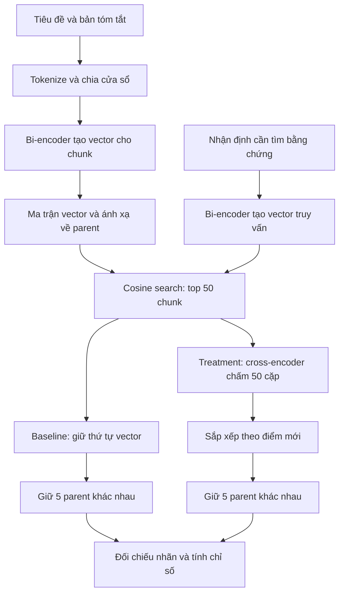
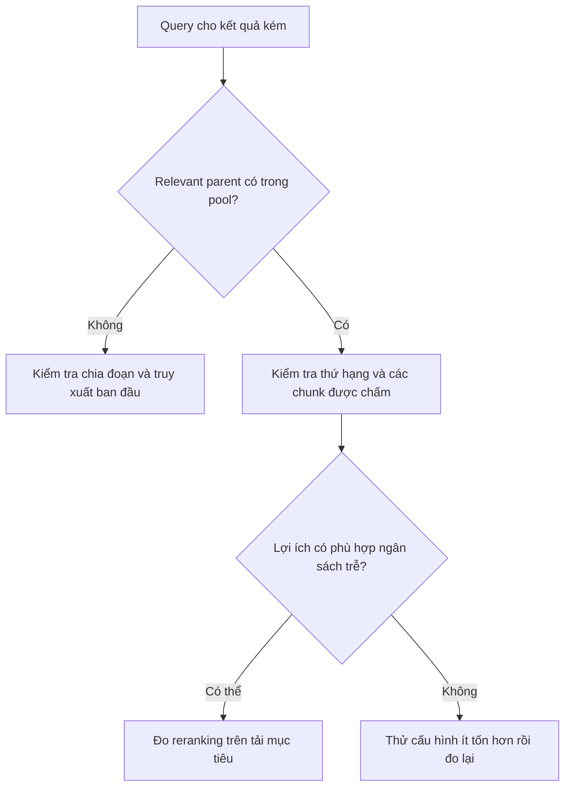

# C4 từ nền tảng đến bảo vệ seminar: Chunking và Reranking cho RAG

Tài liệu học bằng tiếng Việt, giữ thuật ngữ tiếng Anh để đối chiếu với [report](../REPORT.md), [slide](../slides.pdf) và [kịch bản tiếng Việt](../TALK.vi.md). Mục tiêu là giúp bạn tự giải thích cơ chế, tính chỉ số, đọc bằng chứng và bảo vệ kết luận của nhóm. Các ví dụ tự tạo được ghi rõ; số liệu thí nghiệm lấy từ [kết quả đã lưu](../results/20261121T122915162545Z/summary.json).

Đây là tài liệu học mở rộng, không thuộc giới hạn ba trang của report. Những phương án chưa được nhóm đo được trình bày như kiến thức nền hoặc đề xuất, không phải kết quả mới.

## Lộ trình học

| Chặng | Nội dung | Dấu hiệu đã hiểu |
| --- | --- | --- |
| 1 · Nền tảng | Mục 1–4 | Vẽ được đường đi từ tài liệu đến năm kết quả |
| 2 · Cơ chế | Mục 5–8 | Giải thích được chunk size, overlap và hai loại encoder |
| 3 · Thí nghiệm | Mục 9–12 | Tính được MRR/recall và phân biệt ba loại độ trễ |
| 4 · Kết luận | Mục 13–16 | Giải thích số liệu, lỗi và giới hạn mà không nói quá |
| 5 · Thực hành | Mục 17–21 | Đọc log, trả lời câu hỏi và hoàn thành bài tập |

Học từng chặng rồi tự nói lại bằng lời của mình. Khi chưa giải thích được một thuật ngữ, quay lại ví dụ trước khi học thuộc lời thoại.

## 1. Bài toán ban đầu: tìm đúng bằng chứng

Giả sử bạn có hàng nghìn bài báo. Bạn cần tìm bằng chứng liên quan đến một nhận định, chẳng hạn một tác dụng sinh học của aspirin. Bạn không thể đưa toàn bộ kho tài liệu vào một lời nhắc cho mô hình sinh: có giới hạn đầu vào và chi phí xử lý. Hệ thống cần chọn một lượng nhỏ văn bản hữu ích.

**RAG — Retrieval-Augmented Generation** kết hợp truy xuất thông tin bên ngoài với mô hình sinh. Có thể hiểu theo ba việc:

1. Tìm các phần tài liệu có khả năng liên quan.
2. Chọn và đưa chúng vào ngữ cảnh đầu vào.
3. Yêu cầu mô hình tạo câu trả lời dựa trên ngữ cảnh đó.

Truy xuất sai có thể khiến bằng chứng cần thiết không đến được mô hình. Truy xuất đúng vẫn chưa bảo đảm mô hình đọc đúng, suy luận đúng hoặc trích dẫn đúng. Vì vậy, cần đánh giá từng tầng.

**Nhóm đang đánh giá tầng truy xuất.** Đầu ra thí nghiệm là năm mã tài liệu khác nhau. Nhóm chưa tạo câu trả lời bằng một mô hình ngôn ngữ. [Nguồn nền tảng RAG](https://arxiv.org/abs/2005.11401).

## 2. Từ vựng cốt lõi

| Thuật ngữ | Nghĩa trong bài này |
| --- | --- |
| Corpus | Toàn bộ kho tài liệu được tìm kiếm |
| Document / parent | Tài liệu gốc; ở đây là một bản tóm tắt khoa học kèm tiêu đề |
| Chunk / passage | Một phần văn bản được tách từ tài liệu gốc |
| Query | Đầu vào cần tìm bằng chứng; ở đây là một nhận định khoa học |
| Claim | Nhận định khoa học, không nhất thiết ở dạng câu hỏi |
| Token | Đơn vị do tokenizer xác định; không đồng nhất với từ hoặc ký tự |
| Embedding | Vector số biểu diễn văn bản trong không gian của mô hình |
| Index | Cấu trúc lưu biểu diễn tài liệu để tìm kiếm; ở đây dùng ma trận vector |
| Candidate pool | Tập ứng viên đi vào bước xếp hạng lại |
| Relevance judgment / qrels | Nhãn dùng để đánh giá tài liệu có liên quan với truy vấn |
| Baseline | Phương án gốc làm mốc so sánh |
| Treatment | Phương án có thay đổi đang được kiểm tra |
| Inference | Chạy mô hình đã có để tạo vector hoặc điểm; khác với huấn luyện |
| Top-k | k kết quả đứng đầu một danh sách xếp hạng |
| Latency | Thời gian xử lý một truy vấn theo ranh giới đo đã định |

Một tài liệu có thể tạo nhiều chunk. Vì vậy, “50 chunk” và “50 tài liệu” là hai số lượng khác nhau.

## 3. Toàn bộ pipeline của nhóm



**Trước khi nhận truy vấn:** tải dữ liệu/mô hình, chia chunk, tạo vector cho corpus. Công việc này không nằm trong độ trễ truy vấn được báo cáo.

**Khi có truy vấn:** mã hóa truy vấn, tìm top 50, có thể rerank, chọn năm parent. Hai phương án tự thực hiện phần truy xuất chung và tự đo thời gian; không lấy kết quả truy xuất đã tính của baseline rồi cấp miễn phí cho treatment.

Sau bước chọn bằng chứng, một ứng dụng hoàn chỉnh có thể lắp ghép ngữ cảnh rồi gọi mô hình sinh. Hai bước đó nằm ngoài thí nghiệm.

## 4. Embedding và cosine similarity

### 4.1 Vector biểu diễn gì?

Embedding biến văn bản thành một dãy số. Mô hình học cách đặt các văn bản vào không gian vector để hỗ trợ so sánh. Đây là biểu diễn học được, không phải bản dịch chắc chắn của ý nghĩa hay một “cơ sở dữ liệu chân lý”. Câu phủ định, số liệu gần giống nhau hoặc thuật ngữ hiếm vẫn có thể gây nhầm lẫn.

Trong nhóm, `all-MiniLM-L6-v2` tạo vector 384 chiều. Bạn không cần đọc được ý nghĩa từng chiều để dùng phép đo khoảng cách. [Model card của đúng revision](https://huggingface.co/sentence-transformers/all-MiniLM-L6-v2/blob/1110a243fdf4706b3f48f1d95db1a4f5529b4d41/README.md).

### 4.2 Công thức

Với vector truy vấn q và vector đoạn d:

```text
cosine(q, d) = (q · d) / (||q|| × ||d||)
```

Tích vô hướng `q · d` là tổng các tích theo từng chiều. Chuẩn L2 là độ dài vector. Nếu cả hai đã được chuẩn hóa về độ dài một, cosine bằng tích vô hướng.

**Ví dụ toán học, không phải vector mô hình thật:** q = (1, 0), d₁ = (1, 0), d₂ = (0, 1). Cosine với d₁ bằng 1, với d₂ bằng 0. Đây chỉ là minh họa phép tính; không có nghĩa mọi điểm bằng 1 đều là bằng chứng đúng.

Code dùng `normalize_embeddings=True` và phép nhân `embeddings @ vector`, sau đó sắp xếp giảm dần. Vì so với mọi vector nên đây là **exact search**. Không có sai số chọn láng giềng do tìm kiếm gần đúng, nhưng mô hình biểu diễn vẫn có thể xếp hạng sai.

## 5. Chunking: chia tài liệu như thế nào?

### 5.1 Vì sao không coi cả tài liệu là một đoạn?

Một tài liệu dài có thể vượt giới hạn tokenizer/mô hình; phần sau có thể bị cắt. Ngoài ra, một vector duy nhất phải đại diện cho nhiều nội dung khác nhau. Chia nhỏ tạo nhiều đơn vị tìm kiếm cụ thể hơn, nhưng kéo theo ranh giới, phần trùng và chi phí lưu trữ.

Giới hạn của mô hình embedding trong code là 256 token. Nhóm chọn cửa sổ 192 token theo tokenizer embedding để có khoảng đệm. Cross-encoder có giới hạn 512 token cho **cả cặp** truy vấn–đoạn, không phải 512 token cho từng bên. Không nên mặc định mọi tokenizer đếm giống nhau hoặc mọi đầu vào đều tránh được truncation.

### 5.2 Window, overlap và stride

```text
window size = số token tối đa trong một cửa sổ
  overlap   = số token chồng lấn giữa hai cửa sổ liên tiếp
   stride   = window size - overlap
```

Cấu hình chính: 192/32, nghĩa là window 192 và overlap 32, không phải chia văn bản theo 192 từ.

```text
Cửa sổ 1: token   1 ................................ 192
Cửa sổ 2:                       161 ............................... 352
                                |------ 32 token chung ------|
Bước trượt: 160 token
```

Chỉ số trong hình tính từ một; code Python bắt đầu từ không. Với tài liệu **giả định** dài 400 token, các cửa sổ là 1–192, 161–352 và 321–400. Cửa sổ cuối có thể ngắn hơn 192.

Với L token và L > 0, số cửa sổ của thuật toán này là:

```text
Nếu L <= W: 1
Nếu L > W:  1 + ceil((L - W) / (W - O))
```

W là window size, O là overlap, cần `0 <= O < W`. Công thức áp dụng riêng từng tài liệu, không lấy tổng token corpus rồi chia vì cửa sổ không chạy xuyên qua tài liệu.

### 5.3 Lợi và hại

| Thay đổi | Lý do có thể hữu ích | Chi phí hoặc rủi ro cần kiểm tra |
| --- | --- | --- |
| Giảm window | Tập trung hơn vào một ý | Mất định nghĩa/ngữ cảnh, thêm vector và ứng viên trùng parent |
| Tăng window | Giữ nhiều ngữ cảnh | Nhiều ý cùng trong một vector, giới hạn đầu vào |
| Tăng overlap | Một phần gần ranh giới có thêm cơ hội nằm trọn trong đoạn khác | Lặp văn bản, tăng ma trận và có thể chiếm nhiều slot top 50 |
| Chia theo câu/đoạn văn | Giữ một đơn vị cấu trúc | Đơn vị có thể quá dài hoặc thiếu ngữ cảnh ở phần khác |
| Semantic chunking | Chọn ranh giới dựa trên nội dung | Cần định nghĩa rõ thuật toán, ngưỡng và chi phí; vẫn phải đo |

Overlap không bảo đảm giữ trọn mọi bằng chứng: bằng chứng có thể dài hơn overlap hoặc nằm ở các phần xa nhau. Không có kích thước luôn tốt nhất cho mọi dữ liệu. [Nghiên cứu về chi phí semantic chunking](https://aclanthology.org/2025.findings-naacl.114/).

## 6. Bi-encoder và cross-encoder

| Đặc điểm | Bi-encoder | Cross-encoder trong thí nghiệm |
| --- | --- | --- |
| Đầu vào | Query và chunk được mã hóa riêng | Query và chunk cùng trong một cặp đầu vào |
| Đầu ra dùng ở đây | Vector | Điểm xếp hạng |
| Tương tác query–chunk | Qua phép so sánh vector sau mã hóa | Có tương tác token trong mô hình khi chấm cặp |
| Tính trước cho tài liệu | Có thể lưu vector chunk | Không thể lưu một điểm dùng chung cho mọi query |
| Vai trò | Lấy ứng viên từ toàn kho | Chấm kỹ tập ứng viên giới hạn |

**Bi-encoder không nhất thiết là hai mô hình khác nhau.** Nhóm dùng cùng một encoder cho hai loại văn bản, chạy độc lập. **Cross-encoder không phải mô hình sinh câu trả lời.** Nó chấm độ liên quan của cặp.

Với N chunk, bi-encoder mã hóa corpus trước rồi so vector truy vấn với các vector đã lưu. Cross-encoder phải xử lý từng cặp khi truy vấn đến; áp dụng nó trên toàn corpus sẽ cần nhiều cặp hơn. Hai tầng giúp giới hạn công việc đắt hơn vào một tập nhỏ. Đây là cơ chế, chưa phải lời bảo đảm cross-encoder luôn tốt hơn.

Nhóm dùng `cross-encoder/ms-marco-MiniLM-L6-v2`, chấm 50 cặp với batch size 16. Batch là nhóm cặp được xử lý cùng đợt; batch 16 không có nghĩa 16 người dùng đồng thời hay thời gian giảm đúng 16 lần. Code sắp xếp theo điểm mới, không cộng điểm cosine và cross-encoder. Điểm là tín hiệu thứ hạng, không được diễn giải thành xác suất nhận định đúng. [Hướng dẫn retrieve-and-rerank](https://www.sbert.net/examples/sentence_transformer/applications/retrieve_rerank/README.html) · [Mô hình reranker đã cố định revision](https://huggingface.co/cross-encoder/ms-marco-MiniLM-L6-v2/tree/233902d25c440f23af6f7d6e94d2946bac0bee0a).

## 7. Top 50 chunk, top 5 parent và loại trùng

**Ví dụ minh họa:** thứ tự chunk là `A:0, A:1, B:0, C:0, B:1, D:0, E:0`. Chúng chỉ đại diện cho năm tài liệu A–E. Sau loại trùng, thứ tự parent là `A, B, C, D, E`.

Nhóm không lấy năm chunk đầu rồi mới loại trùng, vì có thể chỉ còn ba parent. Nhóm duyệt danh sách đã xếp hạng, lấy lần xuất hiện đầu tiên của mỗi parent đến khi đủ năm. Trong treatment, rerank chunk trước, rồi mới loại trùng parent. Vì vậy, chunk có thứ hạng tốt nhất của tài liệu quyết định vị trí của tài liệu.

Qrels ở cấp tài liệu nên mỗi tài liệu liên quan chỉ được tính một lần. Trong dữ liệu đo, 50 chunk ứng viên có trung bình 35,32 parent khác nhau và mọi pool đều đủ ít nhất năm parent. Do đó, baseline trả đúng năm parent đầu khi quét thứ tự vector đầy đủ. Tuy nhiên, baseline vẫn trả chi phí tìm/sắp xếp top 50 theo thiết kế dùng chung; đây chưa phải hệ thống được tối ưu riêng cho top 5.

## 8. Candidate coverage: trần mà reranker không vượt được

Nếu tài liệu A không có chunk nào trong top 50, cross-encoder không được nhìn thấy A. Đổi thứ tự 50 phần tử không thể thêm phần tử thứ 51.

Gọi R là tập parent được gán nhãn liên quan; P là các parent có trong pool:

```text
Pool recall của query = |P ∩ R| / |R|
Oracle recall@5       = min(5, |P ∩ R|) / |R|
```

Oracle là giả định biết nhãn hoàn hảo để xếp tài liệu liên quan lên đầu, không phải một mô hình mà nhóm đã triển khai. Khi một truy vấn có hơn năm tài liệu liên quan trong pool, pool recall và oracle recall@5 có thể khác nhau. Trong dữ liệu này, mức tổng hợp được báo cáo cùng là 88,63% ở cấu hình chính; không nên coi hai khái niệm luôn đồng nhất.

**Trước khi chọn giải pháp:** nếu không có bằng chứng trong pool, kiểm tra truy xuất ban đầu/chunking/số ứng viên. Nếu có nhưng bị đẩy xuống thấp, kiểm tra xếp hạng. Cần nhìn log mới phân biệt được.

## 9. Thiết kế thí nghiệm: nhóm đang chứng minh điều gì?

### 9.1 Hai so sánh khác nhau

| Thí nghiệm | Giữ cố định | Thay đổi | Đo được |
| --- | --- | --- | --- |
| Chính | Chunk 192/32, top 50, corpus, query, host | Thứ tự vector → thứ tự cross-encoder | Chất lượng và độ trễ qua năm lượt |
| Bổ sung | Truy xuất vector, overlap 32, query | Window 192 → 96 | Chất lượng và kích thước ma trận trong một lượt |

Không thể dùng kết quả bổ sung để khẳng định “96 token rerank tốt hơn 192 token” hoặc “chunk nhỏ chạy nhanh hơn”: hai điều này chưa đo.

### 9.2 Vì sao dùng baseline và kiểm soát?

Nếu đổi đồng thời mô hình, window, CPU và số ứng viên, một cải thiện không thể quy riêng cho reranking. So sánh chính giữ các yếu tố đó cố định để đánh giá thay đổi thứ hạng trong pipeline đã định.

Mỗi nhận định chạy qua cả hai phương án: đó là **paired comparison**. Nhóm luân phiên phương án chạy trước để giảm thiên lệch thứ tự, xáo trộn query với seed 42–46 và làm nóng ba query cho mỗi arm trước khi đo. Những biện pháp này tăng tính minh bạch nhưng không loại hết mọi nhiễu của máy.

### 9.3 Dữ liệu và môi trường

SciFact có nhận định và tài liệu được gán nhãn bằng chứng. Nhóm dùng bản phân phối BEIR, 5.183 abstract và 300 test claim có positive judgments. Nhận định có thể bị bằng chứng bác bỏ mà tài liệu vẫn liên quan. Tài liệu không được gán nhãn không tự động chắc chắn vô ích; quy tắc đánh giá hiện tại cho chúng zero credit. [SciFact](https://aclanthology.org/2020.emnlp-main.609/) · [Nguồn dữ liệu và revision](SOURCES.md).

Host đo: i5-11400H, bốn CPU logic nhìn thấy được, bốn thread cho PyTorch/BLAS, CPU float32, truy vấn tuần tự. Không suy ra số nhân vật lý chỉ từ giới hạn thread. Thông tin phiên bản đầy đủ nằm trong [Methods](../REPORT.md) và [environment.json](../results/20261121T122915162545Z/environment.json).

Nhóm dùng mô hình có sẵn để suy luận, không huấn luyện lại trên 300 claim này. Năm lượt tạo 1.500 quan sát theo cặp; vẫn chỉ có 300 claim khác nhau. Thứ hạng giống nhau giữa các lượt nên chất lượng không dao động, còn thời gian có dao động. Chưa xác minh liệu dữ liệu huấn luyện của các mô hình có chồng lấn SciFact.

## 10. MRR@5 và Recall@5: tự tính được mới thực sự hiểu

R là tập parent liên quan của query; D₅ là năm parent khác nhau được trả về.

```text
RR@5 = 1 / hạng của parent liên quan đầu tiên trong D₅
       hoặc 0 nếu không có hit
MRR@5 = trung bình RR@5 của các query

Recall@5(query) = |D₅ ∩ R| / |R|
Recall@5 báo cáo = trung bình recall từng query (macro average)
```

**Ví dụ minh họa với R = {A, B}:**

| Xếp hạng | RR@5 | Recall@5 | Giải thích |
| --- | ---: | ---: | --- |
| C, A, D, E, F | 1/2 | 1/2 | Hit đầu ở hạng 2, tìm được một trong hai |
| A, C, B, D, E | 1 | 1 | Hit đầu ở hạng 1, tìm được cả hai |
| A, C, D, E, F | 1 | 1/2 | MRR chưa quan tâm đến việc thiếu B |
| C, D, E, F, G | 0 | 0 | Không có hit |

Nếu parent liên quan đầu tiên ở hạng 6 hoặc thấp hơn thì RR@5 bằng zero, không phải 1/6. Vì đo ở cutoff 5, chỉ xét năm kết quả đầu.

**Macro khác micro:** query 1 có một relevant và tìm được một; query 2 có ba relevant và tìm được một. Macro recall = (1 + 1/3)/2 = 2/3. Gộp hai hit chia bốn relevant cho 1/2 là micro recall, không phải cách report này dùng.

MRR được viết dạng 0,6105 hoặc 61,05%; đó là cùng một trị số chuẩn hóa. Nó không có nghĩa “61,05% claim có câu trả lời đúng”. MRR là trung bình nghịch đảo thứ hạng. Recall 77,72% là macro recall, không phải tỷ lệ claim đúng hoặc phần trăm chunk có bằng chứng.

### Điểm phần trăm khác phần trăm tương đối

```text
MRR: 0,6105 → 0,6720
Chênh lệch = 0,0615 = 6,15 điểm phần trăm (pp)
Mức tăng tương đối = 0,0615 / 0,6105 ≈ 10,07%
```

Report dùng pp. Recall tăng 4,64 pp khi tính trên số chưa làm tròn; lấy 77,72 − 73,07 ra 4,65 là ảnh hưởng của làm tròn đầu vào. Đây là lý do cần giữ dữ liệu gốc.

## 11. Latency: tổng thời gian, phần tăng thêm và phân vị

### 11.1 Đồng hồ bắt đầu và kết thúc ở đâu?

```text
Baseline: query encoding + exact search/sort + parent collapse
Treatment: query encoding + exact search + cross-encoder/sort + parent collapse
```

Không tính: tải mô hình/dữ liệu, tạo chunk, tạo vector corpus, nạp mô hình, warmup, sinh câu trả lời. “Warm” nghĩa là mô hình đã được nạp và đã chạy trước; không có nghĩa cache kết quả query. “Sequential” nghĩa là xử lý từng query, không đo người dùng đồng thời.

### 11.2 p50, p95 và range

P50 là phân vị 50%, thường gọi là trung vị. P95 mô tả ngưỡng gần phía chậm của phân phối; không phải worst case. Code sắp xếp thời gian và nội suy tuyến tính ở vị trí `(n − 1) × p`. Với mẫu nhỏ, phân vị có thể nằm giữa hai quan sát.

Nhóm tính p50/p95 riêng trong mỗi lượt, rồi lấy **median của năm giá trị**. Phần `[min–max]` là nhỏ nhất/lớn nhất của năm tóm tắt lượt. Nó không phải khoảng thời gian của mọi query, không phải khoảng tin cậy 95%, và không phải p95 của tất cả 1.500 query gộp lại.

### 11.3 Vì sao không trừ hai p95?

Với mỗi query i, trước hết tính `delta_i = treatment_i − baseline_i`, sau đó mới lấy phân vị của các delta trong lượt.

**Ví dụ minh họa, đơn vị ms:**

| Query | Baseline | Treatment | Delta theo cặp |
| --- | ---: | ---: | ---: |
| q1 | 1 | 101 | 100 |
| q2 | 2 | 3 | 1 |
| q3 | 100 | 101 | 1 |

P50 treatment − p50 baseline = 101 − 2 = 99, nhưng p50 delta = 1. Dùng đúng phép nội suy trong code, p95 treatment − p95 baseline = 101 − 90,2 = 10,8; p95 delta = 90,1. Các phân vị của hai arm có thể gắn với query khác nhau, nên không cộng/trừ như từng quan sát.

Trong kết quả thật: total treatment p95 **2001,0 ms**; paired added p95 **1928,3 ms**. Khoảng hai giây là tổng truy xuất của treatment, chưa tính phục vụ và sinh đáp án; khoảng 1,93 giây là phần tăng thêm theo cặp. Đổi ms sang giây bằng cách chia 1.000.

## 12. Đọc bảng kết quả chính

| Chỉ số | Vector | Reranked | Cách diễn giải |
| --- | ---: | ---: | --- |
| MRR@5 | 61,05% | 67,20% | Trung bình nghịch đảo hạng của hit liên quan đầu tiên tăng |
| Recall@5 | 73,07% | 77,72% | Thu hồi được phần lớn hơn của tập relevant mỗi query |
| Total p50 | 27,6 ms | 1554,4 ms | Chi phí điển hình tăng nhiều trên host này |
| Total p95 | 115,7 ms | 2001,0 ms | Phải tính ngân sách đuôi trễ trước khi triển khai |
| Paired added p50 | — | +1511,0 ms | Phân vị 50 của chênh lệch theo query, tổng hợp qua lượt |
| Paired added p95 | — | +1928,3 ms | Phân vị 95 của chênh lệch theo query, tổng hợp qua lượt |

Range đầy đủ nằm ở Table I của report và [summary.json](../results/20261121T122915162545Z/summary.json). Không chọn lượt tốt nhất để đưa ra kết luận.

RR@5 theo claim: **67 tăng / 193 bằng / 40 giảm**. Recall: **30 tăng / 259 bằng / 11 giảm**. Một phương pháp tốt hơn về trung bình vẫn có thể gây hại cho một phần truy vấn; vì vậy phải xem cả wins và losses.

## 13. Đọc ba case thật và phân tích lỗi

| Claim | Quan sát từ log | Kết luận được phép |
| --- | --- | --- |
| 5 | Parent liên quan `13734012`: vector parent rank 8 → reranked rank 1 | Reranker đưa một ứng viên sẵn có vào top 5 |
| 535 | Parent liên quan `39368721`: rank 1 → ngoài top 5 | Reranking cũng có thể làm mất hit |
| 132 | Parent liên quan `7975937` vắng trong pool | Reranker không thể cứu query này chỉ bằng đổi thứ tự pool |

Không tự suy luận “vì cross-encoder hiểu phủ định tốt hơn” từ rank. Muốn giải thích nguyên nhân ngôn ngữ, phải kiểm tra query, nội dung chunk, nhãn và lỗi tiềm năng của chúng.

**Phân rã any-hit của lượt đầu:**

| Trạng thái | Số claim |
| --- | ---: |
| Cả hai arm đều có ít nhất một hit trong top 5 | 214 |
| Baseline không hit, treatment có hit | 25 |
| Baseline có hit, treatment mất mọi hit | 10 |
| Cả hai không hit dù pool có relevant | 19 |
| Pool không có relevant | 32 |
| Tổng | 300 |

Treatment không hit trên 61 claim = 32 thiếu ứng viên + 29 có relevant nhưng ngoài top 5; 29 = 19 + 10. “Có ít nhất một hit” khác với RR hoặc macro recall. Vì thế 25 new hits không mâu thuẫn với 67 RR improvements: một query vốn đã có hit vẫn có thể cải thiện thứ hạng.

## 14. Hiểu thí nghiệm chunking bổ sung

| Đặc điểm | 192/32 | 96/32 |
| --- | ---: | ---: |
| Stride | 160 | 64 |
| Tỷ lệ overlap | 16,7% | 33,3% |
| Số chunk | 12.434 | 27.090 |
| Ma trận embedding | 18,21 MiB | 39,68 MiB |
| MRR@5 | 61,05% | 61,78% |
| Recall@5 | 73,07% | 74,47% |
| Pool recall | 88,63% | 89,70% |

Giữ overlap tuyệt đối 32 không có nghĩa tỷ lệ overlap giữ nguyên. Đồng thời thay đổi lượng ngữ cảnh trong vector, số vector và sự cạnh tranh cho 50 slot. Vì thế nói “hai cấu hình này khác nhau thế nào” chính xác hơn “đã cô lập tác động thuần túy của độ dài”.

Ma trận float32 có kích thước `số chunk × 384 chiều × 4 byte`. Ví dụ cấu hình chính: `12.434 × 384 × 4 = 19.098.624 byte`, tương đương 18,21 MiB. Một MiB bằng 1.048.576 byte. Đây chỉ là ma trận, không phải toàn bộ RAM ứng dụng. Model weights, tokenizer, văn bản và bộ nhớ trung gian còn chiếm thêm.

Kích thước ma trận tăng khoảng 2,18 lần; MRR tăng 0,73 pp và recall tăng 1,40 pp. RR@5 tăng trên 39 query, bằng trên 221, giảm trên 40. Số query giảm nhiều hơn một không ngăn mean tăng, vì **độ lớn** mỗi thay đổi cũng quan trọng.

Không so mức tăng chunking với reranking như một cuộc thi “cùng điều kiện chi phí”: chưa đo latency của chunking bổ sung và chưa đo tổ hợp 96 token + reranker.

## 15. Những giới hạn bạn phải giải thích được

1. **Document relevance khác passage evidence.** Chunk thuộc abstract liên quan có thể không chứa câu bằng chứng. Nhãn parent không chứng minh context thực tế đầy đủ.
2. **Relevance khác truth.** Abstract bác bỏ claim vẫn có thể là tài liệu cần tìm.
3. **Retrieval khác generation.** MRR tốt hơn chưa chứng minh câu trả lời đúng hơn, ít bịa hơn hoặc trích dẫn tốt hơn.
4. **Repeat khác generalization.** Lặp cùng 300 query mô tả biến động host; không tạo 1.500 query độc lập. Không có kiểm định ý nghĩa thống kê hoặc khoảng tin cậy trong report.
5. **Warm sequential khác production load.** Chưa đo cold start, nhiều request đồng thời, throughput hoặc xếp hàng. Không suy throughput production bằng cách đảo median latency.
6. **Một model pair/corpus/host.** Chưa chứng minh mọi reranker, ngôn ngữ hoặc miền dữ liệu có cùng trade-off.
7. **Judgment incompleteness và training overlap.** Tài liệu chưa gán nhãn nhận zero credit; dữ liệu huấn luyện có thể có chồng lấn chưa xác minh.
8. **Thiết kế baseline cụ thể.** Cả hai dùng exact top-50 chung; một hệ thống tối ưu top-5 hoặc approximate search có chi phí khác.

Một câu trả lời bảo vệ tốt có ba phần: **đã đo gì → thấy gì → phạm vi nào còn chưa biết**.

## 16. Chọn giải pháp và đề xuất bước tiếp theo



**Khuyến nghị từ kết quả đã có:** cân nhắc reranking khi cải thiện thứ hạng đáng với tổng p95 truy xuất khoảng hai giây trên CPU này. Nếu cần nhanh hơn, giữ vector order là baseline hợp lý để đánh giá. Nếu evidence không vào pool, ưu tiên chẩn đoán retrieval.

**Các hướng học tiếp, chưa có kết quả trong nhóm:**

| Hướng | Ý tưởng | Cần đánh giá lại |
| --- | --- | --- |
| Candidate depth | Thử nhiều hoặc ít ứng viên hơn | Coverage, chất lượng, thời gian chấm cặp |
| Lexical/hybrid retrieval | Kết hợp tín hiệu khớp từ với dense retrieval | Cách hợp nhất, candidate recall và chi phí |
| Boundary-aware splitting | Giữ câu/đoạn văn hoặc nhóm nội dung | Passage evidence, kích thước index, thời gian |
| Approximate nearest neighbors | Tìm ứng viên gần đúng thay vì quét mọi vector | Độ chính xác truy xuất và tốc độ trên corpus lớn |
| Selective reranking | Chỉ bật reranker theo quy tắc cho một số query | Chất lượng toàn workload, tỷ lệ bật và tail latency |
| Serving optimization | Thử phần cứng, batching hoặc mô hình khác | Tải đồng thời, precision, memory, cold start |

Đây là câu hỏi thử nghiệm. Không mặc định một tối ưu sẽ giữ nguyên ranking hoặc chắc chắn tăng tốc. Tăng ứng viên cũng không bảo đảm recall@5 sau reranking luôn tăng.

## 17. Đọc repository và tự xem bằng chứng

### 17.1 File nào làm gì?

| File | Vai trò | Câu hỏi bạn nên tự trả lời |
| --- | --- | --- |
| [config.json](../config.json) | Các tham số và revision | Candidate k và output k khác nhau thế nào? |
| [prepare.py](../ragstudy/prepare.py) | Tải input cố định, tokenize, tạo chunk | Title và abstract ghép ở đâu? |
| [measure.py](../ragstudy/measure.py) | Exact search, cross-encoder, timer | Vì sao hai arm đều trả chi phí query encoding? |
| [common.py](../ragstudy/common.py) | Window, loại trùng, metric, quantile | RR zero khi nào? Percentile nội suy ra sao? |
| [replay.py](../ragstudy/replay.py) | Kiểm tra log và tính lại thống kê | Vì sao replay chưa phải đo mới? |
| [chunk_ablation.py](../ragstudy/chunk_ablation.py) | So sánh window bổ sung | Vì sao không kết luận latency ở đây? |
| [environment.json](../results/20261121T122915162545Z/environment.json) | Host, package, hash và cấu hình lúc chạy | Kết quả thuộc môi trường nào? |
| [run-01.json](../results/20261121T122915162545Z/run-01.json) | Query, qrels, candidate, score, thời gian | Có reconstruct lại thứ hạng được không? |
| [summary.json](../results/20261121T122915162545Z/summary.json) | Tổng hợp pass và across-runs | Số trong report truy ngược về đâu? |

### 17.2 Thực hành nhanh không cần tải mô hình

Chạy từ thư mục gốc repository bằng Python tiêu chuẩn:

```bash
study_dir=$(cat results/latest-study.txt)
make replay RESULTS="$study_dir"
python3 -m ragstudy.chunk_ablation "$study_dir" --replay
```

Hai lệnh replay xác thực và tính lại từ log đã lưu. Chúng không chạy lại mô hình nên không tái đo milliseconds trên máy bạn.

Tự kiểm tra ví dụ metric và quantile ở trên:

```bash
python3 - <<'PY'
from ragstudy.common import metrics, percentile, token_windows

print('Vector:', metrics(['C', 'A', 'D', 'E', 'F'], {'A', 'B'}))
print('Rerank:', metrics(['A', 'C', 'B', 'D', 'E'], {'A', 'B'}))
baseline = [1, 2, 100]
treatment = [101, 3, 101]
added = [t - b for t, b in zip(treatment, baseline)]
for p in (0.5, 0.95):
    print('p =', p,
          'difference of percentiles =', percentile(treatment, p) - percentile(baseline, p),
          'percentile of paired differences =', percentile(added, p))
print('Toy token-window lengths:', [len(w) for w in token_windows(list(range(400)), 192, 32)])
PY
```

Kết quả mong đợi: hai dict chất lượng lần lượt `(recall 0.5, RR 0.5)` và `(recall 1, RR 1)`; hai cách lấy phân vị khác nhau như mục 11; độ dài cửa sổ là `[192, 192, 80]`. Python có thể in số thực rất gần 10,8 thay vì đúng chuỗi `10.8` do biểu diễn số thực.

Muốn xem log claim 5/535/132, dùng đoạn trace trong [TALK.vi.md](../TALK.vi.md). Đọc cả relevant ID, candidate pool và final docs, thay vì chỉ nhìn một headline.

### 17.3 Đo lại đầy đủ

```bash
make setup
make prepare
make study
```

Làm theo [README](../README.md) về Linux/WSL x86-64, Python 3.12 và dung lượng. Đo mới chạy mô hình và có thể mất thời gian; giữ máy ít tải và không chạy job cạnh tranh. Kết quả mới nằm ở thư mục timestamp mới; không sửa log cũ để khớp report. Dùng tên model giống nhau chưa đủ tái lập: cần revision, input, package, cấu hình và điều kiện máy.

## 18. Bản đồ đọc report và thuyết trình

| Report | Bạn cần hiểu | Slide liên quan |
| --- | --- | --- |
| Abstract / Introduction | Câu hỏi, ý nghĩa và kết quả chính | 1–2 |
| Methods: corpus và chunks | Token, window, overlap, parent | 3–5 |
| Methods: baseline và treatment | Bi-encoder, cross-encoder, controls | 3, 5 |
| Methods: metrics và aggregation | RR/recall, macro, paired percentiles | 6, 8 |
| Results A, Table I | Chất lượng, thời gian, gains/losses | 7–9 |
| Results B, Table II | 96/32 so với 192/32 và storage | 10 |
| Discussion | Khuyến nghị có điều kiện và limits | 11–12 |
| Conclusion / Reproducibility | Kết luận vừa sức dữ liệu, kiểm tra lại | 12–13 |
| References / source register | Nguồn cho mô hình và khái niệm | 16 |

**Cách tự giải thích mỗi slide:** nêu câu hỏi slide giải quyết, giải thích hình hoặc số, nói một hàm ý, rồi chuyển ý. Không cần đọc lại toàn bộ chữ.

**Phần của Hiếu:** slides 5–9. Bạn cần nắm chắc controls, macro average, paired latency, ba case thật và candidate ceiling. Tuy nhiên, giảng viên có thể hỏi bất kỳ thành viên về toàn bộ pipeline.

## 19. Câu hỏi bảo vệ và hướng trả lời

1. **Tại sao chọn chủ đề này?** Chọn bằng chứng liên quan ảnh hưởng context của RAG; nhóm muốn đo lợi ích của reranking cùng chi phí có đơn vị cụ thể.
2. **Reranking có tìm thêm tài liệu không?** Trong pipeline này không. Nó chỉ đổi thứ tự cùng 50 chunk được retriever chọn.
3. **Vì sao không dùng cross-encoder ngay từ đầu?** Có thể chấm toàn corpus về mặt thiết kế, nhưng sẽ cần nhiều query–chunk pairs hơn. Nhóm dùng bi-encoder để giới hạn số cặp chấm online.
4. **192 và 32 có tối ưu không?** Chưa chứng minh. Đây là cấu hình chính cố định và một so sánh bổ sung 96/32, không phải sweep tìm tối ưu.
5. **Vì sao chỉ chọn top 50 và top 5?** Đó là candidate depth và cutoff của câu hỏi đăng ký. Nhóm chưa đo mọi giá trị khác.
6. **Vì sao năm lượt mà chất lượng giống nhau?** Dùng lại cùng input và thứ hạng xác định. Lặp chủ yếu quan sát biến động thời gian, không tạo dữ liệu kiểm thử mới.
7. **MRR tăng có đồng nghĩa recall tăng không?** Không luôn. Đẩy một relevant từ hạng 2 lên 1 tăng RR nhưng giữ nguyên recall nếu số relevant trả về không đổi.
8. **Vì sao added p95 không bằng hai p95 trừ nhau?** Phân vị không có tính cộng; phải ghép cùng query rồi trừ trước. Dùng ví dụ mục 11 nếu được hỏi sâu.
9. **P95 hai giây có nghĩa request nào cũng dưới hai giây?** Không. Đó là phân vị của các thời gian trong protocol, không phải worst case hay cam kết dịch vụ.
10. **Vì sao không có generator?** Câu hỏi đăng ký đánh giá retrieval bằng nhãn tài liệu. Generator cần thiết kế và bộ tiêu chí khác.
11. **Tại sao 39 query tốt lên, 40 tệ đi mà mean tăng?** Mỗi query có thể tăng/giảm với độ lớn khác nhau; đếm dấu thay đổi chưa đủ để suy ra mean.
12. **Chunk nhỏ có nhanh hơn không?** Nhóm chưa đo. Số vector tăng, lượng văn bản mỗi cặp giảm và số bước xử lý thay đổi; cần đo thực tế.
13. **Làm thế nào biết code thực sự tạo ra số liệu?** Truy ngược report → summary → raw scores/rank/timing; dùng replay để reconstruct và kiểm tra. Replay kiểm tra tính nhất quán log, không độc lập chứng minh mọi điều kiện vật lý lúc đo.
14. **Kết luận có áp dụng cho tiếng Việt không?** Chưa có thí nghiệm tiếng Việt. Kịch bản tiếng Việt là bản giải thích; dữ liệu và mô hình trong study vẫn theo cấu hình đã ghi.
15. **Có thể khẳng định reranker hiểu đúng bằng chứng không?** Chưa. Nó tạo điểm xếp hạng; document label và một case rank tốt không chứng minh hiểu ngôn ngữ hoặc evidence sufficiency.
16. **Nên làm gì tiếp theo?** Chẩn đoán coverage so với ordering; đo candidate depth rồi tổ hợp chunking/reranking, passage evidence và serving load theo controls rõ ràng.

Nếu chưa đo một hướng, câu trả lời đúng là: “Nhóm chưa đánh giá trường hợp đó; để kết luận, cần giữ các điều kiện này cố định và đo các chỉ số này.”

## 20. Bài tập tự kiểm tra

Làm trước khi mở đáp án.

1. Tài liệu 500 token, window 192, overlap 32 tạo bao nhiêu chunk? Ghi khoảng token từ một.
2. Relevant = {A, B, C}; kết quả `[D, A, E, B, F]`. RR@5 và recall@5 bằng bao nhiêu?
3. Đổi thành `[A, D, E, F, G]`. RR tăng hay giảm? Recall tăng hay giảm?
4. Pool chỉ có một relevant trong hai relevant tổng cộng. Oracle recall@5 tối đa bao nhiêu? Reranker có thể đạt 100% recall không?
5. Vì sao `77,72 − 73,07` khác gain recall 4,64 pp trong report?
6. Matrix 27.090 × 384 float32 chiếm bao nhiêu byte? Đó có phải tổng RAM không?
7. Nếu giảm candidate depth và chất lượng vẫn giữ nguyên, bạn đã có đủ bằng chứng kết luận latency giảm chưa?
8. Dùng một câu phân biệt full rerun và replay.
9. Giải thích `61 = 32 + 29` bằng ngôn ngữ của candidate coverage và ordering.
10. Tự thuyết trình hai phút không nhìn script: cơ chế → protocol → một gain → một cost → một limit.

<details>
<summary>Đáp án và gợi ý</summary>

1. Ba chunk: 1–192, 161–352, 321–500. Công thức: `1 + ceil((500−192)/160) = 3`.
2. RR = 1/2; recall = 2/3.
3. RR tăng lên 1; recall giảm còn 1/3. Hai chỉ số trả lời câu hỏi khác nhau.
4. Tối đa 1/2. Không thể 100% nếu giữ nguyên pool và chỉ đổi thứ tự.
5. Số trong bảng đã làm tròn; gain tính từ số gốc, không từ hai số đã làm tròn.
6. 41.610.240 byte, khoảng 39,68 MiB. Chỉ là embedding matrix.
7. Chưa. Cần đo latency theo cùng protocol; số cặp ít hơn là thay đổi công việc, chưa phải con số tốc độ đã kiểm chứng.
8. Full rerun chạy mô hình và đo thời gian mới; replay tính lại/kiểm tra log đã lưu.
9. Trong 61 query treatment không hit, 32 không có relevant trong pool; 29 có relevant nhưng final top 5 không chọn được.
10. Không cần đọc mọi số: có thể dùng +6,15 pp MRR, tổng p95 khoảng hai giây và giới hạn document labels.

</details>

## 21. Tự kiểm tra trước ngày trình bày

- Vẽ được pipeline và chỉ đúng phần tính trước/phần tính online.
- Tự tính window, overlap, cosine đơn giản, RR và macro recall.
- Phân biệt top 50 chunk với top 5 parent, quality với truth và retrieval với generation.
- Đọc được Table I, kể cả range và paired added latency.
- Giải thích được 67/193/40 và 61 = 32 + 29 mà không lẫn các chỉ số.
- Giải thích được vì sao 96/32 tăng storage và vì sao chưa kết luận latency.
- Chạy được replay và chỉ được query 5 trong log.
- Trả lời được “đã đo gì, kết quả gì, giới hạn gì” mà không nhìn script.

Nếu chưa làm được một mục, học lại phần tương ứng thay vì cố thuộc lòng slide. Mục tiêu là bạn tự bảo vệ được lựa chọn và số liệu.

## Nguồn và phạm vi kiến thức

Các giải thích về triển khai và số liệu dựa trên code, cấu hình và log của repository; model card và hướng dẫn retrieve-and-rerank được đọc lại ngày 26/11/2026. Các nguồn gốc:

- [Lewis et al. — RAG](https://arxiv.org/abs/2005.11401): nền tảng kết hợp retrieval và generation.
- [Sentence Transformers — Retrieve & Re-Rank](https://www.sbert.net/examples/sentence_transformer/applications/retrieve_rerank/README.html): vai trò bi-encoder và cross-encoder.
- [Embedding model tại revision đã dùng](https://huggingface.co/sentence-transformers/all-MiniLM-L6-v2/blob/1110a243fdf4706b3f48f1d95db1a4f5529b4d41/README.md): vector và giới hạn đầu vào.
- [Reranker tại revision đã dùng](https://huggingface.co/cross-encoder/ms-marco-MiniLM-L6-v2/tree/233902d25c440f23af6f7d6e94d2946bac0bee0a): model và tài nguyên cố định.
- [Wadden et al. — SciFact](https://aclanthology.org/2020.emnlp-main.609/): nhận định và nhãn evidence.
- [Qu et al. — Semantic chunking](https://aclanthology.org/2025.findings-naacl.114/): động lực phải đánh giá cả chất lượng và chi phí splitter.
- [Source register](SOURCES.md), [validation](VALIDATION.md), [review](REVIEW.md): attribution, nguồn số liệu và kiểm tra đã thực hiện.

Các ví dụ vector hai chiều, cửa sổ 400/500 token và bảng latency ba query là ví dụ giảng dạy, không phải quan sát SciFact. Những hướng nâng cao ở mục 16 chỉ giới thiệu ý tưởng để học tiếp; không phải cam kết triển khai hay kết quả của study này.
